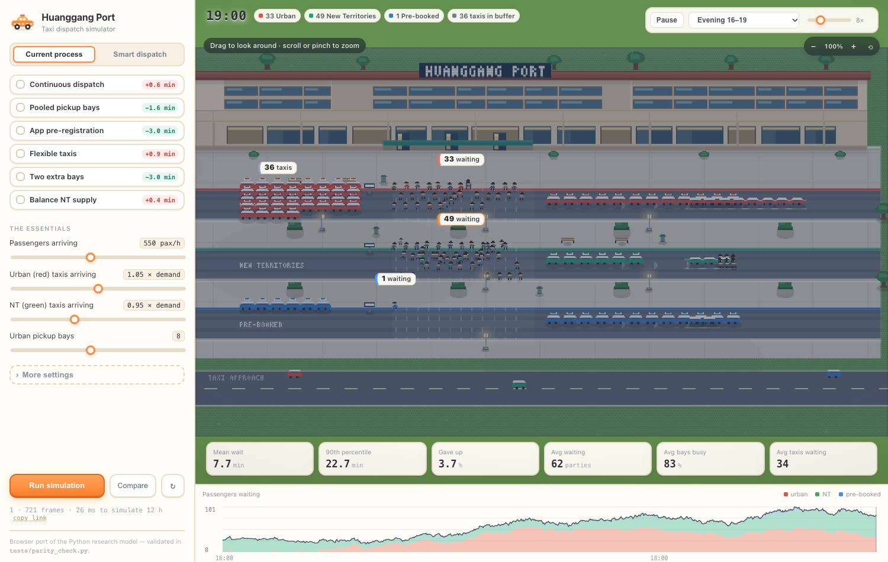
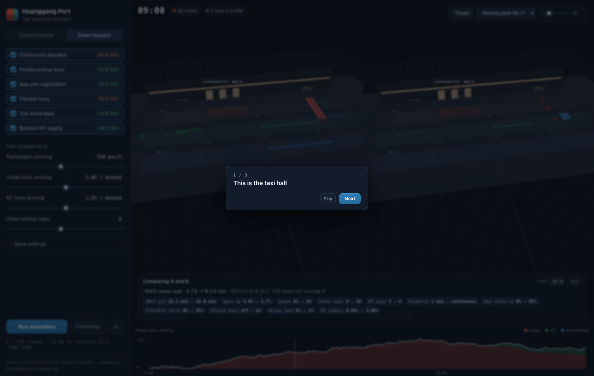

# Huanggang Port Taxi Dispatch Simulation

A discrete-event simulation (DES) of the empty-taxi buffer, the pickup bays and
the passenger queues at Huanggang Port, used to measure how the **current manual
dispatch process** performs and to test **smart-dispatch policies** before they
are implemented.

The whole study runs from one command:

```bash
python3 -m venv .venv
source .venv/bin/activate
pip install -r requirements.txt
python run_experiments.py --reps 30
```

Everything is written to `results/` (CSV, a report-ready markdown table and seven
figures). A full run takes about 2 minutes on a laptop.

---

## 1. What the model represents

```
                          HUANGGANG PORT TAXI HALL
                          ========================

  empty taxi ──▶ ┌──────────────┐   release    ┌──────────────┐   board    ┌─────────┐
   (Poisson)     │ BUFFER ZONE  │ ──────────▶  │ PICKUP BAYS  │ ─────────▶ │ departs │
                 │  urban lane  │  (manual:    │  8 urban     │  service   │  loaded │
                 │  NT lane     │   1 platoon  │  3 NT        │  1.5 min   └─────────┘
                 │  flex pool   │   per min)   │  2 pre-book  │
                 └──────────────┘              └──────────────┘
                        ▲                             ▲
                        │ buffer full?                │
                        │ circle 8–20 min             │
                        │                             │
  passenger ──▶ ┌──────────────────────┐              │
   (Poisson,    │ QUEUES               │──────────────┘
    time-varying│  urban  |  NT  | pre-book
    rate)       └──────────────────────┘
                        │
                        └── gives up after ~35 min (measured, not ignored)
```

Each entity is explicit:

* **Passengers** arrive as a non-homogeneous Poisson process (hourly profile
  with morning and evening peaks), join the queue of their destination class,
  and abandon the queue if their patience runs out.
* **Empty taxis** arrive as a separate Poisson process, queue in the buffer zone
  of their lane, are released to the pickup bays, and leave empty if they are
  not called forward in time. A taxi that enters the wrong lane is redirected
  and has to circulate (8–20 min of lost capacity).
* **Pickup bays** are multi-server stations: registration + boarding + luggage +
  payment takes 1.5 min on average with realistic variability.
* **Fleet / pre-booked taxis** use a separate channel and do not consume the
  walk-up bays.

The engine is policy-agnostic: the "current process" and the "improved process"
are the *same code* with different settings, which is what makes the comparison
fair.

## 2. Files

| File | Purpose |
|---|---|
| `run_experiments.py` | main entry point: runs every scenario, sweep, validation and figure |
| `taxi_sim/engine.py` | the discrete-event simulation (no dependencies) |
| `taxi_sim/scenarios.py` | the calibrated baseline + all policy variants |
| `taxi_sim/stats.py` | confidence intervals, Erlang-C benchmark |
| `taxi_sim/plots.py` | figures |
| `tests/test_engine.py` | 9 invariant tests (conservation, Little's law, capacity bounds) |
| `tests/parity_check.py` | proves the website's engine matches the Python research model |
| `web/` | the interactive 2.5D pixel simulator (static site — see section 2b) |
| `serve.py` | local preview server for the website |
| `render.yaml` | one-click deploy to Render |
| `config_site.example.json` | template for your own field measurements |
| `results/` | all outputs of the last run |

Useful commands:

```bash
python run_experiments.py                 # default: 20 replications
python run_experiments.py --reps 50       # tighter confidence intervals
python run_experiments.py --quick         # 5 replications, smoke test
python run_experiments.py --no-plots      # numbers only
python run_experiments.py --validate      # Erlang-C check only
python run_experiments.py --config config_site.json   # use your field data
python tests/test_engine.py               # invariant tests
```

## 2b. Interactive 2.5D pixel simulator (website)

> **Visual direction.** The scene is hand-authored pixel art in a 2.5D
> arrangement: the ground is drawn in plan, while taxis, people and props are
> billboard sprites anchored at their feet and sorted by depth. This is the
> "Stardew" camera — the whole rank stays visible, but the vehicles still have
> silhouettes. Every sprite is a character grid in `web/js/pixel/sprites.js`;
> there are no image files, models or texture downloads.

`web/` is a self-contained static site: a pixel view of the taxi hall with
sliders for every input. It is the same model as the Python engine,
re-implemented in JavaScript so it can be hosted for free with **no server and
no cold start**. The renderer draws into a 640x360 buffer and scales with
nearest-neighbour, so the pixel size is constant at any window size; portrait
screens get their own framing rather than a letterboxed strip.

The view is not locked: **drag to look around, scroll or pinch to zoom
(1x–4x), double-click to reset**. Pan and zoom move a window over the finished
frame, so the art keeps its authored pixel size instead of resampling.



*Left panel: every parameter from section 3. Right: the hall at 17:30 — 51 urban
passengers waiting, the urban buffer drained, the NT buffer full. Toggle
"All four on" and the same moment has no queue at all.*

**Compare a proposal against the current process**



*Left A = current process, right B = your proposal, same seed and same clock.
The bar underneath states whether the difference is real: it runs both scenarios
for N replications and refuses to claim an effect when the 95% intervals overlap.*

* **Policy cards** — four measures, each showing its effect on mean wait when
  applied alone, so you can see which suggestion actually moves the needle.
  Three booking ideas were tested; only the return-trip booking survived, because
  the fleet channel and app pre-registration are secondary (about 1.3 minutes)
  and only pay off after the ticket. They remain in *More settings*.
* **Diff strip** — lists only what differs (`Urban bays 8 → 10`,
  `Dispatch 1 min → continuous`), which is the literal answer to
  "did anything change?".
* **Trials** — 1 / 10 / 30 replications, with a verdict that says
  "−55%, CIs do not overlap" or "no measurable difference".
* **Editable in one minute** — only four headline inputs and the four policy
  cards are shown; everything else is behind *More settings*. Sliders apply
  automatically (a run takes ~30 ms), so there is no Run button to forget.
* **Shareable** — *copy link* encodes the whole scenario in the URL, and a
  3-step tour runs on the first visit.
* On a phone the split becomes an **A/B swap** (one scene at a time, `Show A`
  button) because two live scenes would waste memory on a phone.

**What you can do**

* Drag to orbit, scroll to zoom.
* Switch between **As it runs today**, **All four on** and **★ Recommended** presets.
* Change demand, taxi supply, bays, boarding time, dispatch cycle, misapplied
  routing, app share, patience, buffer size — then hit **Run**.
* Scrub through the day (morning peak / midday / evening peak / whole shift) and
  change playback speed.
* Read the KPIs (mean wait, p90, abandonment, queue, bay utilisation) with the
  delta against the current process.
* Deep-link any state:
  `?preset=smart&window=2&t=90` (evening peak, 17:30).

**Run it locally**

```bash
python serve.py            # http://localhost:8000
```

**Deploy to Render**

1. Push this repository to GitHub.
2. Render → **New** → **Blueprint** → pick the repo. `render.yaml` is already in
   the repo: it declares a *static site* with publish path `./web`, so there is
   no build step and no server to pay for.
3. Or manually: **New → Static Site**, build command empty, publish directory
   `web`. Done — every push redeploys.

**Why a JavaScript port, and how it is kept honest**

Hosting the Python engine would need a web service (a cold-starting container) just
to compute numbers the browser can compute in ~50 ms. The trade-off is two
implementations of one model, so `tests/parity_check.py` runs both engines on the
same configuration and requires every metric's **95% confidence interval to
overlap**:

```bash
python tests/parity_check.py            # current process
python tests/parity_check.py --smart    # smart dispatch package
```

Typical agreement is within 1–5% on wait time, p90, abandonment, queue length and
utilisation. The most sensitive combination (pooled bays + flexible taxis) drifts
by ~8% — still inside the confidence intervals, but worth knowing when you quote
a number from the website rather than from the thesis tables.

**Recording a clip for your slides**

```bash
node tests/record.mjs "?preset=baseline&window=0" results/demo.mp4 540 30 180
#                                 query            output        frames fps minutes
```

Produces a 1500×950, 30 fps H.264 video with ffmpeg. `tests/shoot.mjs` captures a
single still. Both drive the system Chrome through `playwright-core`, so no
browser download is needed.

---

## 3. Parameters — and how to measure each one on site

The defaults below reproduce a *congested but plausible* port. Replace them with
your observations; the model then becomes evidence rather than illustration.
This table doubles as your data-collection plan.

| Parameter (JSON key) | Default | Meaning | How to measure |
|---|---|---|---|
| `pax_per_hour` | 550 | walk-up passengers per hour | Count arrivals at the taxi hall for 3–4 days; average per hour |
| `party_size` | 1.3 | passengers per taxi trip | Observe ~100 departures |
| `prebook_share` | 0.10 | share using fleet / pre-booked taxis | Booking-system records |
| `urban_share` | 0.75 | urban (red) vs NT (green) split | Count each queue for a shift |
| `taxi_supply_ratio_urban` / `_nt` | 1.05 / 0.95 | empty-taxi flow ÷ passenger flow | **Queue-ticket logs** give this directly (tickets issued per hour) |
| `taxi_supply_basis_pax` | 550 | demand level at which supply was measured | Your `pax_per_hour` on the survey day |
| `supply_lag_hours` | 2 | how late taxi supply peaks vs demand | Cross-correlate the hourly taxi and passenger series |
| `buffer_capacity` | 40 | buffer spaces **per lane** | Count the marked spaces |
| `stands` | 8 / 3 / 2 | pickup bays per class | Count on site |
| `stand_queue_capacity` | 12 | taxis that can wait at the bays | Count the holding lane |
| `service_mean_min` | 1.5 | boarding transaction time | Stopwatch 50 boardings |
| `service_cv` | 0.60 | variability of that time | sd ÷ mean of the same sample |
| `dispatch_interval_min` | 1.0 | how often staff call a platoon forward | Time the dispatcher for an hour |
| `dispatch_batch` | 8 | taxis released per call | Count per call |
| `misroute_prob` | 0.06 | taxis entering the wrong lane | Count for two hours |
| `patience_mean_min` | 35 | how long before a passenger gives up | Short exit interviews / count reneges |
| `taxi_patience_mean_min` | 45 | how long an empty taxi waits before leaving | Follow 20 taxis in the buffer |
| `recirc_min` / `recirc_max` | 8 / 20 | time lost circulating | Follow a redirected taxi |

`demand_profile` (24 hourly multipliers) and `nt_shift_hours` shape the peaks;
`supply_flatness` controls how badly taxi supply follows demand.

## 4. The policies tested

| ID | Policy | What changes in the model | Type |
|---|---|---|---|
| — | **Baseline** | one staff-led platoon release per minute, fixed 8/3 bay split, 6% misrouting, 25% app use | current process |
| P1 | Continuous dispatch | release is event-driven instead of a 1-minute staff cycle | software |
| P2 | Pooled pickup bays | the 11 walk-up bays serve whichever lane has a passenger waiting | layout + software |
| P3 | App pre-registration | 85% of passengers pre-registered, boarding 25% faster | software |
| P4 | Flexible taxi pool | 35% of taxis may serve either urban or NT passengers | regulation |
| P5 | Two extra bays | 10 urban + 4 NT bays | capital works |
| P6 | Digital lane routing | misrouting falls from 6% to 1% | signage + app |
| P7 | Balance NT supply | NT taxi supply raised from 0.95 to 1.05 of demand | incentives |
| — | **All operational** | P1+P2+P3+P4+P6, no new bays | package |
| — | **Smart dispatch (full)** | operational package + 2 extra bays | Step 2 |

> The website's **All four on** preset enables the four cards on the page (ticket,
> return booking, driver information, extra stands). The *smart dispatch* package in
> this table is a wider research scenario from the earlier design and is not the same
> button.

### Driver incentives (supply-side policies)

Every policy above acts *inside* the port. None of them help if taxis do not
turn up — and the reason drivers skip Huanggang is the **return leg**: a taxi
that takes a fare to the port has no guaranteed fare back, so the trip is worth
less than an hour in the city. This is a repositioning problem, not a licensing
one: the taxi stays on the Hong Kong side and needs a passenger heading back
into town. Three supply-side instruments are modelled:

| Policy | Parameter | What the model assumes it does |
|---|---|---|
| Return-trip booking | `return_pickup` 0–1 | share of drop-offs that take a passenger back into Hong Kong instead of deadheading; today about 40%, the booking policy lifts it |
| Port pickup surcharge | `port_surcharge_hkd` 0–50 | a regulated extra fare on trips leaving the port |
| Waiting-time allowance | `wait_allowance_hkd` 0–4 | paid per minute spent queueing at the port |

Supply response, identical in both engines:

```
available supply = base_ratio x pickup_share x ticket x (1 + 0.45*surcharge/50 + 0.30*allowance/4)
```

The return-booking coefficient is **0.35**: full matching raises supply by 35%,
deliberately less than the trip's revenue gain, so the headline does not depend
on drivers responding one-for-one. A sweep from 0.20 to 0.60 moves the
recommended package's wait from 6.2 to 4.0 minutes — the direction never
changes, only the size.

**The coefficients are illustrative, not measured.** No driver supply
elasticity has been published for this port, so
`experiments/incentive_sweep.py` answers *"what does the model do if the
response looks like this"* — not *"what will happen"*.

Two results are robust to the coefficients, because they follow from the queue
ceasing to be supply-limited rather than from the sizes involved:

- **Incentives saturate.** Matching only 20% of return trips captures most of
  the benefit; going to 100% adds little.
- **They substitute rather than add.** All three at once is no better than the
  best single policy at a moderate setting.

| Setting | Mean wait (min) | vs baseline |
|---|---|---|
| Baseline (550 pax/h, no incentives) | 6.14 ± 0.55 | — |
| 20% of trips matched | 3.89 | −2.25 |
| 40% of trips matched | 3.60 | −2.54 |
| +50 HKD surcharge | 2.91 | −3.23 |
| 4 HKD/min allowance | 3.21 | −2.93 |
| all three at once | 3.29 ± 0.39 | −2.85 |

Eight replications per row, seeds 11–18 (`results/incentive_sweep.txt`).

### The queue-ticket regime (October 2026)

The rebuilt port opened on 12 October 2026 with a **paper queue ticket**: every
empty taxi must collect one at a public transport buffer zone before it can
reach the rank. The taxi trade reports **~8 minutes per trip**, paid by the
driver, and has asked the Transport Department to review it.

The model carries this as `ticket_delay_min`, and it enters as driver time
rather than passenger time:

```
supply = base_ratio x T / (T + delay)      T = average taxi time at the port (~25 min)
```

| Ticket delay | Mean wait | vs no ticket | Gave up |
|---|---|---|---|
| 8.0 min (paper, today) | 20.4 min | +13.2 | 18.6% |
| 4.0 min | 15.1 | +7.9 | 8.6% |
| 2.0 min | 10.0 | +2.8 | 4.0% |
| 1.5 min (digital) | 8.9 | +1.8 | 3.1% |
| 0 (no ticket) | 7.1 | — | 1.7% |

Because the hall sits near capacity, a 24% cut in supply does not degrade the
queue linearly — it tips. How strongly drivers actually respond to eight
minutes is unknown: at half the modelled response the penalty is ~22 min
instead of 20, so the *direction* is solid and the magnitude is an upper bound.

**Note:** the results table below was produced *before* the ticket regime, so
its baseline is the no-ticket world (7.7 min). The website now runs with the
8-minute ticket by default.

### Sequencing: the ticket has to be fixed first

With the paper ticket in place, app pre-registration and extra stands measure at
**zero**. The hall is starved of taxis, so making boarding faster or adding
stands changes nothing. Once a digital ticket restores supply, the same two
policies are each worth about **1.3 minutes**:

| | paper ticket (8 min) | digital ticket (1.5 min) |
|---|---|---|
| baseline | 20.2 min | 8.8 min |
| + app pre-registration | 20.2 (−0.04) | 7.5 (−1.3) |
| + two extra stands | 20.2 | 7.5 (−1.3) |

This is why the policy cards show almost nothing until you switch the ticket on.

### The return leg: a booking, not a border quota

The taxi never crosses the boundary. It drops a passenger at Huanggang and needs
someone going back into Hong Kong. A cross-border quota would let Hong Kong
taxis pick up *inside* Shenzhen — a different policy, for a different regulator,
requiring a bilateral agreement. It would not fill the empty Hong Kong-bound
leg, and the model never simulated it: the old card was a +50% supply
multiplier with a border story attached.

What the model does simulate is the share of drop-offs that leave with a booked
trip back. A passenger arriving from Shenzhen books a Hong Kong taxi before
clearing immigration; the booking goes to a taxi that has just dropped off, and
it uses its own stand, so the walk-up queue is untouched. That is a
repositioning fix: the same car, already at the port, leaves loaded.

| | Mean wait | Gave up |
|---|---|---|
| today | 19.3 min | 18.0% |
| digital ticket only | 8.9 min | 4.5% |
| return booking only | 8.8 min | 3.9% |
| **both** | **5.4 min** | **0.7%** |

The same runs show the mechanism: drop-offs that go back empty fall from **60%**
to **20%** once the booking policy is on.

Thirty replications of `BASE`, seeds 1–30. The browser engine gives 19.7, 9.7,
8.9 and 5.9 for the same rows, inside the confidence intervals reported by
`tests/parity_check.py`. The booking's effect is a modelling assumption (the
supply response is illustrative), so treat the size as an upper bound and the
direction as the finding.

### Sensitivity: which assumptions matter

Twenty replications per point, swinging each assumption around the current
baseline (paper ticket, 550 pax/h, 20.2 min):

| Assumption | Swing | Change |
|---|---|---|
| Demand ±20% | 440–660 pax/h | **17.7 min** |
| Taxi supply ±20% | 0.84–1.26× | 12.7 |
| Passenger patience | 25–45 min | 11.6 |
| Ticket delay | 4–12 min | 7.3 |
| How much the ticket deters drivers | dwell 20–32 min | 2.7 |
| Live information share | 0–60% | 1.9 |
| Boarding time | 1.2–1.8 min | 0.2 |

The headline is dominated by demand and supply because the hall sits near
capacity — a property of queueing systems, not of the model. Among the things
that were *assumed* rather than measured, patience matters most, then the ticket
response. Boarding time barely matters: the stands are not the constraint.

### Which policies fit this port

| Policy | Fits Huanggang today? |
|---|---|
| Digital queue ticket | yes — the live issue, and what the trade asked for |
| App / fleet pre-registration | yes — fleet taxis are already bookable |
| Two extra stands | capital works; the PTI layout is fixed as built |
| Return-trip booking | yes — booked trips use their own stand, so the walk-up queue is untouched |
| Port pickup surcharge | no — HK fares are uniform by meter, no location surcharge |
| Flexible taxis | no — green taxis stay licensed for NT destinations |
| Pooled pickup bays | no — red and green have separate stands by licence |
| Continuous dispatch, digital lane routing | measured at ~0 min either way |
| Overnight minimum service | no measurable effect: the model has more taxis than passengers after midnight |
| Red taxis helping the NT queue | legal, but measures at zero in both urban-heavy and NT-heavy mixes |

## 5. Results (default calibration, 30 replications each)

Mean ± 95% confidence interval. Replications use **common random numbers**, so
differences between rows are policy effects rather than sampling noise.

Waits here are measured over **served passengers only**, which is the
conventional definition. The website's headline KPI uses
`wait_mean_incl_abandon` — the same mean with people who gave up counted up to
the moment they left — because a policy that shortens the queue by driving the
longest waiters to abandon would otherwise look better than it is. Both
metrics are produced by both engines and compared in `tests/parity_check.py`.

| Scenario | Mean wait (min) | 90th pct wait | Gave up (%) | Avg passengers waiting | Max waiting | Bay utilisation (%) | Taxis in buffer | Taxi time at port (min) | Throughput (pax/h) | Change in mean wait |
|---|---|---|---|---|---|---|---|---|---|---|
| Baseline (current process) | 7.7 ± 0.6 | 21.4 ± 0.6 | 3.4 ± 0.4 | 59.4 ± 4.5 | 157 ± 6 | 81.8 ± 0.4 | 37.4 ± 2.3 | 25.5 ± 1.7 | 535 ± 3 | — |
| P1 Continuous dispatch | 7.6 ± 0.6 | 21.1 ± 0.8 | 3.3 ± 0.4 | 58.8 ± 4.4 | 155 ± 6 | 80.6 ± 0.4 | 37.9 ± 2.2 | 25.1 ± 1.5 | 535 ± 3 | -1% |
| P2 Pooled pickup bays | 6.5 ± 0.5 | 20.7 ± 0.8 | 3.1 ± 0.3 | 51.1 ± 3.7 | 156 ± 5 | 82.4 ± 0.5 | 36.0 ± 2.2 | 23.3 ± 1.6 | 538 ± 3 | -15% |
| P3 App pre-registration | 5.2 ± 0.4 | 20.7 ± 0.8 | 3.0 ± 0.4 | 41.8 ± 3.4 | 154 ± 6 | 66.5 ± 0.5 | 33.5 ± 2.3 | 21.9 ± 1.6 | 539 ± 3 | -32% |
| P4 Flexible taxi pool | 6.6 ± 0.5 | 19.2 ± 0.7 | 1.9 ± 0.3 | 50.0 ± 4.1 | 147 ± 7 | 82.4 ± 0.5 | 34.0 ± 1.6 | 18.9 ± 1.4 | 545 ± 3 | -14% |
| P5 Two extra bays | 5.2 ± 0.4 | 20.6 ± 0.8 | 3.0 ± 0.4 | 41.8 ± 3.3 | 154 ± 6 | 68.0 ± 0.5 | 33.4 ± 2.3 | 22.2 ± 1.7 | 539 ± 3 | -33% |
| P6 Digital lane routing | 7.6 ± 0.6 | 21.3 ± 0.7 | 3.3 ± 0.4 | 59.2 ± 4.6 | 156 ± 5 | 81.8 ± 0.4 | 37.5 ± 2.1 | 24.8 ± 1.6 | 536 ± 3 | -0% |
| P7 Balance NT supply | 6.5 ± 0.4 | 19.9 ± 0.6 | 2.6 ± 0.3 | 50.2 ± 3.2 | 155 ± 5 | 82.2 ± 0.5 | 54.6 ± 3.4 | 27.9 ± 1.6 | 541 ± 3 | -16% |
| All operational measures | 3.6 ± 0.3 | 17.0 ± 1.0 | 1.7 ± 0.3 | 28.9 ± 2.5 | 143 ± 8 | 65.1 ± 0.4 | 30.2 ± 2.3 | 15.9 ± 1.6 | 550 ± 3 | -53% |
| Smart dispatch (full package) | 3.6 ± 0.3 | 17.0 ± 1.0 | 1.8 ± 0.3 | 28.8 ± 2.5 | 143 ± 8 | 52.7 ± 0.4 | 30.3 ± 2.4 | 15.9 ± 1.6 | 550 ± 3 | -53% |

### What the results say

1. **The current process is queue-limited at the peaks, not on average.**
   Average wait is 7.7 min, but the 90th percentile is 21.4 min and the queue
   peaks at ~157 parties. Bay utilisation is 82%, i.e. the port is busy but not
   saturated all day — the pain is concentrated in two windows.
2. **The urban/NT split is real but second-order (−15%).** In the afternoon the
   NT lane saturates its 3 bays while urban taxis idle in the buffer, so pooling
   the bays recovers capacity at zero capital cost. On its own it is not enough:
   the largest single levers are boarding time (−32%) and two extra bays (−33%).
3. **Manual dispatch speed is *not* currently binding (−1%).** At one platoon
   per minute the dispatcher is inside the safe region. The heat map
   (`fig4_dispatch_heatmap.png`) shows a cliff: below ~5 taxis/minute the wait
   doubles, and below ~2.5 taxis/minute the system collapses (40 min waits, 60%+
   giving up). This matters for staffing decisions — one dispatcher on a break
   during the peak is enough to trigger it.
4. **Boarding time is a large lever (−32%).** Pre-registration cuts the
   transaction by 25% and buys a third of the peak capacity.
5. **Flexibility buys fairness, not just speed (−14% mean, −10% p90, and
   abandonment almost halves).** Flexible taxis fill the lane that is starving,
   which is exactly what an "urban queue empty / NT queue long" afternoon needs.
6. **The package halving the wait needs no new concrete.** All operational
   measures give −53% mean wait and −20% on the 90th percentile; adding two bays
   on top changes nothing measurable (utilisation falls to 53%), so capital works
   should not be the first move.
7. **Smart dispatch cannot fix a taxi shortage.** In the demand sweep
   (`fig3_demand_sweep.png`) both policies converge at ~850 passengers/hour:
   once empty taxis, not bays, are the constraint, only supply-side policy (P7)
   helps.

## 6. Mapping to your research questions

| Question | Where the answer comes from |
|---|---|
| **RQ1** How efficient is the current system? | `baseline` row: 7.7 min mean, 21.4 min p90, 3.4% give up, 82% bay utilisation, 37 taxis queueing in the buffer |
| **RQ2** What drives passenger wait? | P1–P7 one-at-a-time comparison + the dispatch heat map + the patience sweep (Fig. 7) |
| **RQ3** Can a smart algorithm reduce queues? | `all_operational` and `smart_full` vs `baseline`; time series in Fig. 2 |
| **RQ4** How do policies perform? | the full table, the demand sweep (Fig. 3) and the 5×5 staffing surface (Fig. 4) |

Steps 1–3 of the brief map one-to-one onto `baseline`, `smart_full` and the
comparison printed at the end of every run.

## 7. Why you can trust the numbers

* **Replications, not single runs.** Every scenario is run 30 times with
  independent seeds and reported with a 95% confidence interval. Any difference
  whose intervals overlap is not a result.
* **Common random numbers.** All scenarios use the same seed list, so the
  comparison is paired and much less noisy.
* **Analytical validation.** With taxis made unlimited and all frictions
  switched off, the pickup bays become a pure M/M/c queue. The engine reproduces
  the Erlang-C mean wait to within a few percent across the load range, and to
  within 1–3% near saturation (`results/validation_mmc.csv`, Fig. 6).
* **Little's law.** For every replication, `L = λ_served·W_served +
  λ_abandoned·W_abandoned` is checked against the simulated time-average queue
  length; the gap is reported as `little_gap_pct` (typically < 2%).
* **Invariant tests.** `tests/test_engine.py` checks conservation of entities,
  capacity bounds, arrival-rate accuracy and the expected direction of every
  policy effect.
* **No silent failures.** The runner prints a consistency warning if utilisation
  exceeds 100%, if Little's law drifts, or if more customers finish than arrive.

## 8. Assumptions and limitations (use this section in your report)

* Taxi arrivals are **exogenous**: drivers do not learn or respond to the queue
  length within the day. `supply_lag_hours` approximates their slow response.
* No road network or routing: entry, buffer, bays and exit are abstract
  resources. This keeps the model transparent and fast, but it cannot answer
  questions about traffic on the approach roads.
* Pooling bays (P2) assumes the lane geometry allows a taxi of either class to
  reach any bay. If the lanes are physically separated, P2 is not implementable
  as modelled — this is a site-verification item.
* Passenger patience is not observed directly; the default (lognormal, mean
  35 min) is an assumption, and Fig. 7 shows how much the *reported* mean wait
  depends on it. A shorter tolerance hides the tail (censoring).
* The pre-booked channel is modelled as an independent queue with guaranteed
  supply; interaction between fleet taxis and the walk-up pool is not modelled.
* The supply response to driver incentives is **assumed, not estimated**: the
  three coefficients in section 4 are a plausible shape, not a measurement.
  The saturation and substitution results follow from the queue leaving the
  supply-limited regime, so they survive a wide range of coefficient values —
  but the *sizes* of the effects should not be quoted as predictions.
* A 1-hour warm-up is discarded; results describe the 11 measured hours.
* The service-time distribution is lognormal (CV 0.6). Exponential service is
  available (`service_dist="exp"`) for the analytical validation.

## 9. Extending the study

* Add a policy: write a new `replace(BASE, ...)` in `scenarios.py` and add it to
  `ORDER`/`LABELS` — no engine changes needed.
* Add a decision rule (e.g. "hold a taxi for a pre-booked passenger if the queue
  is below *n*"): edit `_release` / `_serve` in `engine.py`; the hooks are
  isolated.
* Add a cost model: multiply `taxi_dwell_mean` by the driver's hourly cost and
  `party_abandoned` by the value of a lost trip to turn minutes into HK$.
* Run longer horizons or 24-hour profiles by changing `duration_hours` and
  `start_hour`.

---

### Reproducing the tables and figures in this README

```bash
python run_experiments.py --reps 30 --sweep-reps 15
```

Outputs: `results/summary_table.md`, `scenarios_summary.csv`,
`scenarios_raw.csv`, `dispatch_heatmap.csv`, `sweep_demand.csv`,
`sweep_patience.csv`, `validation_mmc.csv`, and `fig1`–`fig7` PNGs at 300 dpi.
